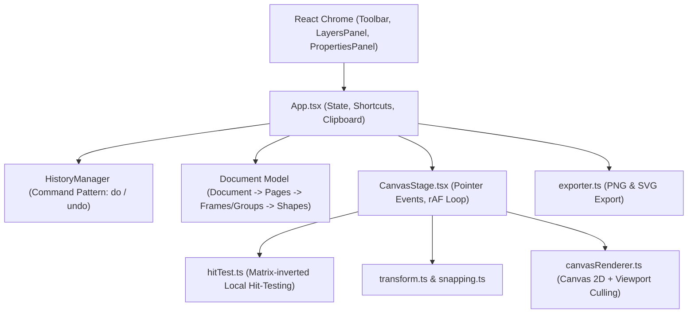

# Mini Figma — Browser Vector Design Editor

A TypeScript + React + Canvas 2D simplified Figma clone built from scratch (no canvas/editor-core libraries such as Fabric.js, Konva, Excalidraw, or tldraw).

---

## Setup & Run

```bash
npm install
npm run dev      # Start Vite dev server
npm test         # Run Vitest unit tests
npm run build    # Typecheck (tsc) and build production bundle
```

---

## Feature Checklist

### Level 1 — Core Canvas
- **Shapes**: Frame (`F`), Rectangle (`R`), Ellipse (`O`), Line (`L`), Text (`T` with double-click inline editing).
- **Selection**: Click to select, `Shift+Click` to toggle/add, drag marquee box for multi-select, `Ctrl/Cmd+Click` to deep-select inside Groups/Frames.
- **Transforms**: Move, resize via 8 handles (including **rotated shapes** with anchored opposite corner/edge and `Shift` aspect-ratio lock), rotate via top handle (`Shift` snaps to 15°).
- **Viewport**: `Ctrl/Cmd + Scroll` zoom centered on cursor, `Space + Drag` or middle-mouse drag to pan, trackpad scroll to pan, zoom controls in toolbar.
- **History (Undo/Redo)**: Command pattern (`do()` / `undo()`) with single-step transactions for drags, resizes, rotations, and live sliders (`Ctrl+Z` / `Ctrl+Shift+Z` or `Ctrl+Y`).
- **Shortcuts**: Delete/Backspace, Duplicate (`Ctrl+D`), Select All (`Ctrl+A`), Escape.

### Level 2 — Real Editor Features
- **Pen Tool (`P`)**: Click for corner anchors, click-and-drag for symmetric cubic Bezier handles, click first point to close or press `Enter` / double-click to finish. Double-click any path to enter **Path Edit Mode** and drag anchor points or Bezier handles.
- **Layers Panel**: Hierarchical tree (Pages → Frames/Groups → Shapes), drag-and-drop reordering & reparenting, double-click to rename, visibility toggle, lock toggle, Group (`Ctrl+G`) / Ungroup (`Ctrl+Shift+G`), multi-page support.
- **Properties Panel**: Live-editable X/Y/W/H/Rotation, Corner Radius, Opacity, Fill, Stroke (color & width), Drop Shadow, Typography (font size, weight, alignment), and Frame Constraints.
- **Smart Guides & Snapping**: Snaps moving shapes to other shapes' edges and centers, plus equal-spacing detection, with magenta guide lines (`Alt` bypasses snapping).
- **Clipboard**: Copy (`Ctrl+C`), Cut (`Ctrl+X`), Paste (`Ctrl+V`), Paste in Place (`Ctrl+Shift+V`).
- **Save & Load**: Export document as `.json`, import `.json` with schema validation, plus automatic `localStorage` persistence.

### Level 3 — Stretch Goals
1. **Export (PNG & SVG)**: Export current selection or entire page as crisp 2x **PNG** or standards-compliant **SVG** (preserving transforms, clipPaths, rounded corners, text, cubic bezier paths, and drop shadows).
2. **Constraints**: Children inside a Frame support `left | right | center | left-right | scale` horizontal constraints and `top | bottom | center | top-bottom | scale` vertical constraints when the parent Frame is resized.

### Performance
- `+500` button in the toolbar spawns 500 rotated shapes to benchmark viewport culling + `requestAnimationFrame` rendering.

---

## Architecture Overview



### Folder Structure
- `src/math/`: 2D affine matrix math (`matrix.ts`), geometry helpers (`geometry.ts`), rotated/nested transform math (`transform.ts`), smart guides (`snapping.ts`).
- `src/model/`: Normalized tree document schema (`types.ts`) and node/constraint helpers (`document.ts`).
- `src/history/`: Command implementations (`commands.ts`) and undo/redo stack (`historyManager.ts`).
- `src/render/`: Canvas 2D renderer (`canvasRenderer.ts`) and local-space hit-testing (`hitTest.ts`).
- `src/state/`: Tree mutations for delete, clone/paste, group/ungroup, reorder, and JSON validation (`documentOps.ts`).
- `src/export/`: PNG and SVG exporters (`exporter.ts`).
- `src/components/`: React UI (`Toolbar.tsx`, `LayersPanel.tsx`, `PropertiesPanel.tsx`, `CanvasStage.tsx`).
- `tests/`: Vitest unit tests for matrices, rotated resize & constraints, hit-testing, and undo/redo history.

---

## Rendering Approach & Justification

I chose **HTML5 Canvas 2D** over SVG DOM or WebGL:
- **Vs. SVG DOM**: SVG creates a DOM node per shape, which degrades during pan/zoom/drag with 500+ shapes. Canvas 2D lets us perform fast AABB viewport culling, `requestAnimationFrame` batching, and zero-DOM-reconciliation renders.
- **Vs. WebGL**: WebGL excels at 10,000+ primitives or shaders, but crisp text rendering, rounded rects, dashed pen-tool previews, and drop shadows require substantial extra scaffolding (MSDF text, tessellation). Canvas 2D gives us native crisp typography, HiDPI (`devicePixelRatio`) scaling, and clean 2D matrix transforms while keeping the codebase focused and maintainable.

---

## Known Limitations & What I Would Build Next
- **Path Editing**: Currently supports dragging existing anchors and handles; adding/deleting anchor points on an existing segment and asymmetric handle breaking (`Alt+drag`) would be next.
- **Multi-select Rotation**: Multi-select supports move and proportional AABB resize; rotating a multi-selection around its combined center is a natural next step.
- **Boolean Operations & Auto-Layout**: Next Level 3 features to add on top of the current tree model.

